# Maison MNIST — un classifieur Fashion-MNIST servi par FastAPI


> Atelier FastAPI — module *Framework du Machine Learning & Deep Learning*, Master SDIA 2, ENSET Mohammedia (2026-2027).
> Encadrante : Pr. Asmae OUHMIDA · Auteur : Badr Eddine TOUBANI

**Démo en ligne : [fashion-mnist-fastapi.streamlit.app](https://fashion-mnist-fastapi-7uhmvvsadrtpp4haxlt3jv.streamlit.app/)**

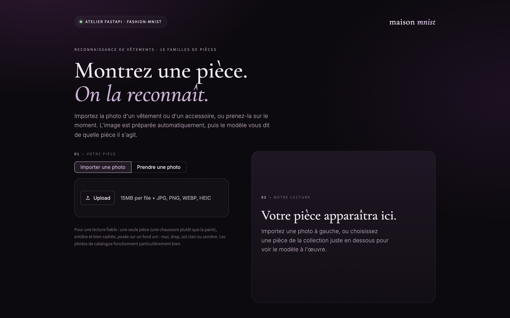

Un modèle Keras entraîné sur Fashion-MNIST est exposé derrière une API REST FastAPI. L'API reçoit une image
de 784 pixels et renvoie sa classe, son score de confiance et la latence d'inférence. Au-delà de l'énoncé, le projet
ajoute une route qui accepte de **vraies photos** (téléphone, catalogue) et les adapte automatiquement au format du
modèle, une interface Streamlit pensée pour un utilisateur non technique, une image Docker et un déploiement sur
Streamlit Community Cloud.

---

## Sommaire

1. [Résultats en bref](#1-résultats-en-bref)
2. [Architecture](#2-architecture)
3. [Structure du dépôt](#3-structure-du-dépôt)
4. [Le modèle](#4-le-modèle)
5. [L'API FastAPI](#5-lapi-fastapi)
6. [Tests de l'API](#6-tests-de-lapi)
7. [Photos réelles : adaptation automatique](#7-photos-réelles--adaptation-automatique)
8. [L'interface Streamlit](#8-linterface-streamlit)
9. [Déploiement](#9-déploiement)
10. [Réponses aux questions d'analyse](#10-réponses-aux-questions-danalyse)
11. [Limites et pistes](#11-limites-et-pistes)
12. [Reproduire](#12-reproduire)

---

## 1. Résultats en bref

| Mesure | Valeur |
|---|---|
| Prédictions correctes sur les 20 images de test | **18 / 20 (90 %)** |
| Contrôle sur 200 images | 178 / 200 (89 %) |
| Latence moyenne d'inférence (serveur) | **1,99 ms** |
| Latence aller-retour vue par le client | ≈ 6,3 ms |
| Entrée de 3 pixels | rejetée, **HTTP 400** + message explicite |
| Photos réelles (Wikimedia Commons) | 5 / 6 bien reconnues |
| Photos simulées après prétraitement (500) | 85,6 % (contre 87,8 % sur les images d'origine) |

Mesures faites sur un MacBook Pro Apple M1 Pro, Python 3.12, TensorFlow 2.21, sans GPU.

---

## 2. Architecture

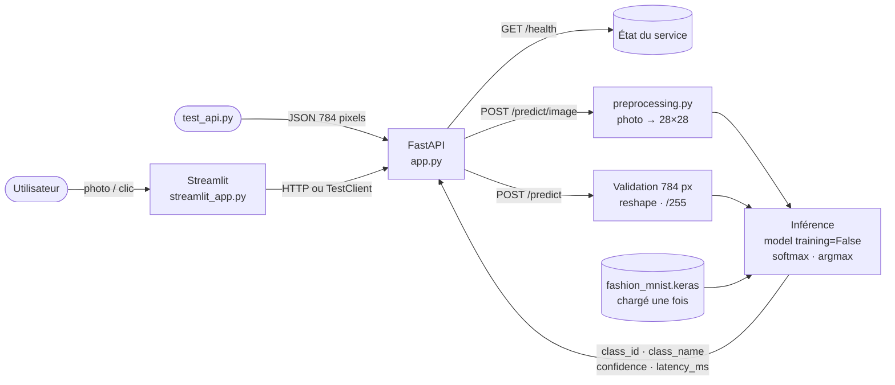

Trois points structurent le projet :

- **Un seul point d'inférence.** `/predict` et `/predict/image` partagent la même fonction `run_inference()` :
  le modèle, le softmax et la mesure de latence sont identiques, seule la préparation de l'entrée change.
- **Le modèle est chargé une fois**, au démarrage du serveur, suivi d'un appel « à blanc » pour que la première
  vraie requête ne paie pas la construction du graphe.
- **Le front ne connaît que l'API.** Streamlit n'importe jamais le modèle directement : il appelle les routes HTTP
  (ou les mêmes routes via `TestClient` sur Streamlit Cloud, voir [§9](#9-déploiement)).

---

## 3. Structure du dépôt

```
.
├── app.py                 # API FastAPI : /, /health, /predict, /predict/image
├── preprocessing.py       # photo réelle → image 28×28 au style Fashion-MNIST
├── test_api.py            # tests : 1 image, 20 images, entrée incorrecte
├── streamlit_app.py       # interface « Maison MNIST »
├── fashion_mnist.keras    # modèle fourni
├── data/                  # jeu de test Fashion-MNIST (10 000 images, format idx)
├── captures/              # captures d'écran (Swagger, /health, prédiction, interface)
├── docs/                  # figures du README
├── compte_rendu.pdf       # compte rendu du TP
├── requirements.txt
├── Dockerfile · docker-compose.yml
└── .streamlit/config.toml # thème sombre de l'interface
```

---

## 4. Le modèle

`fashion_mnist.keras` est un perceptron multicouche :

| Couche | Sortie | Paramètres |
|---|---|---|
| Flatten | (None, 784) | 0 |
| Dense, ReLU | (None, 128) | 100 480 |
| Dense, **linéaire** | (None, 10) | 1 290 |
| **Total** | | **101 770** |

La dernière couche n'a pas d'activation softmax : le modèle renvoie des **logits**. C'est donc l'API qui applique le
softmax pour obtenir des probabilités et un score de confiance.

Les 10 classes, dans l'ordre des sorties : `T-shirt/top`, `Trouser`, `Pullover`, `Dress`, `Coat`, `Sandal`, `Shirt`,
`Sneaker`, `Bag`, `Ankle boot`.

---

## 5. L'API FastAPI

### 5.1 Routes

| Méthode | Route | Rôle |
|---|---|---|
| GET | `/` | Message d'accueil |
| GET | `/health` | Sonde : service en vie, modèle chargé, formes d'entrée/sortie |
| POST | `/predict` | **Route de l'énoncé** : 784 pixels → classe, confiance, latence |
| POST | `/predict?top_k=3` | Même réponse + les k classes les plus probables (optionnel) |
| POST | `/predict/image` | Extension : vraie photo (multipart) → prétraitement → même inférence |

### 5.2 Contrat d'inférence

| Élément | Valeur |
|---|---|
| Point d'entrée | `POST /predict`, `Content-Type: application/json` |
| Entrée | `{"pixels": [784 nombres]}`, image 28×28 aplatie ligne par ligne, valeurs dans [0, 1] ou [0, 255] |
| Prétraitement | `float32` → `reshape (1, 28, 28)` → division par 255 si `max > 1` |
| Modèle | `fashion_mnist.keras`, entrée `(None, 28, 28)`, sortie `(None, 10)` logits |
| Sortie | `class_id` (0–9), `class_name`, `confidence` ∈ [0, 1] (4 décimales), `latency_ms` (2 décimales) |
| Erreurs | `400` si le nombre de pixels ≠ 784 · `422` si le JSON est mal formé (champ absent, valeur non numérique) |
| Supervision | `GET /health` |

### 5.3 Ce que fait `/predict`

Les onze étapes demandées par l'énoncé, dans l'ordre :

```python
@app.post("/predict", responses={400: {"description": "L'entrée ne contient pas exactement 784 pixels"}})
def predict(data: ImageInput, top_k: int | None = Query(None, ge=1, le=10)):
    if len(data.pixels) != 784:                                   # 1-2. contrôle de taille
        raise HTTPException(400, "L'entrée doit contenir exactement 784 pixels.")
    image = np.array(data.pixels, dtype=np.float32)               # 3. NumPy float32
    image = image.reshape(1, 28, 28)                              # 4. batch (1, 28, 28)
    if image.max() > 1.0:                                         # 5. normalisation
        image = image / 255.0
    probabilities, latency_ms = run_inference(image)              # 6-10. inférence, softmax, latence
    return format_result(probabilities, latency_ms, top_k)        # 11. JSON
```

```python
def run_inference(image):
    batch = image.reshape(1, 28, 28)
    start = time.perf_counter()
    logits = model(batch, training=False)                         # passe avant seule
    latency_ms = (time.perf_counter() - start) * 1000
    probabilities = tf.nn.softmax(logits, axis=1).numpy()[0]
    return probabilities, latency_ms
```

La latence est mesurée **autour de l'appel au modèle uniquement**, avec `time.perf_counter()`.

### 5.4 Exemples

```bash
curl -s http://127.0.0.1:8000/health
```
```json
{"status": "healthy", "model_loaded": true, "model_name": "fashion_mnist.keras",
 "input_shape": "(None, 28, 28)", "output_shape": "(None, 10)"}
```

```bash
curl -s -X POST http://127.0.0.1:8000/predict -H "Content-Type: application/json" -d @image0.json
```
```json
{"class_id": 9, "class_name": "Ankle boot", "confidence": 0.9652, "latency_ms": 6.04}
```

```bash
curl -s -X POST http://127.0.0.1:8000/predict/image -F "file=@basket.jpg"
```
```json
{"class_id": 7, "class_name": "Sneaker", "confidence": 0.9919, "latency_ms": 1.86,
 "top_k": [{"class_id": 7, "class_name": "Sneaker",    "probability": 0.9919},
           {"class_id": 8, "class_name": "Bag",        "probability": 0.0079},
           {"class_id": 9, "class_name": "Ankle boot", "probability": 0.0003}],
 "preview": [0, 0, 0, "… 784 entiers : l'image 28×28 réellement vue par le modèle"]}
```

### 5.5 `/health` et Swagger

| `GET /health` | Documentation interactive `/docs` |
|---|---|
| 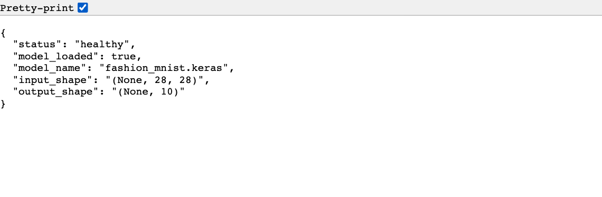 | 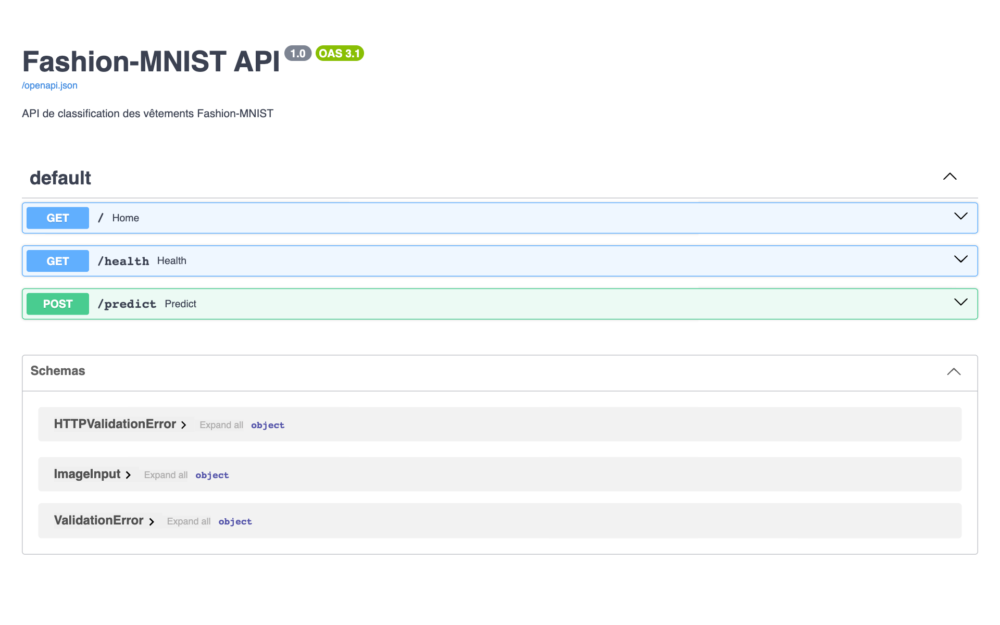 |

FastAPI génère Swagger à partir du code : le schéma `ImageInput` vient de la classe Pydantic, et la réponse 400 est
documentée grâce au paramètre `responses` du décorateur.

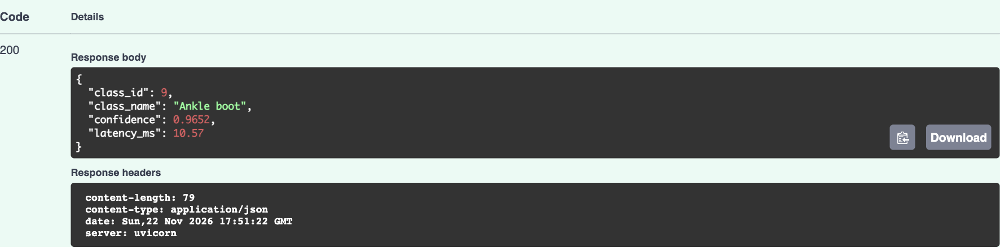

*POST /predict exécuté depuis Swagger sur l'image d'index 0 du jeu de test.*

---

## 6. Tests de l'API

`test_api.py` interroge l'API en HTTP, exactement comme le ferait un client externe :

```bash
uvicorn app:app            # terminal 1
python test_api.py         # terminal 2  (API_URL=https://... pour viser une API déployée)
```

Le script charge Fashion-MNIST (via Keras, ou les fichiers de `data/` si le téléchargement échoue), puis enchaîne trois
tests et enregistre tout dans `resultats.json`.

### 6.1 Une image

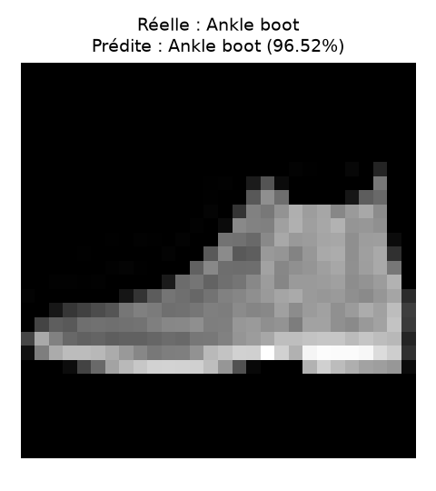

Image d'index 0 : réponse `Ankle boot`, confiance **0,9652**, classe réelle `Ankle boot` → **correct**.
Le script affiche l'image avec la classe réelle et la classe prédite.

<br clear="right">

### 6.2 Vingt images

| Image | Classe réelle | Classe prédite | Confiance | Latence | Résultat |
|---:|---|---|---:|---:|:---:|
| 0 | Ankle boot | Ankle boot | 0,97 | 7,12 ms | ✅ |
| 1 | Pullover | Pullover | 0,99 | 1,80 ms | ✅ |
| 2 | Trouser | Trouser | 1,00 | 2,54 ms | ✅ |
| 3 | Trouser | Trouser | 1,00 | 1,78 ms | ✅ |
| 4 | Shirt | Shirt | 0,68 | 1,98 ms | ✅ |
| 5 | Trouser | Trouser | 1,00 | 1,50 ms | ✅ |
| 6 | Coat | Coat | 0,99 | 1,93 ms | ✅ |
| 7 | Shirt | Shirt | 0,99 | 1,77 ms | ✅ |
| 8 | Sandal | Sandal | 1,00 | 1,86 ms | ✅ |
| 9 | Sneaker | Sneaker | 1,00 | 1,76 ms | ✅ |
| 10 | Coat | Coat | 0,98 | 1,74 ms | ✅ |
| 11 | Sandal | Sandal | 1,00 | 1,51 ms | ✅ |
| 12 | Sneaker | **Sandal** | 0,93 | 1,78 ms | ❌ |
| 13 | Dress | Dress | 1,00 | 1,88 ms | ✅ |
| 14 | Coat | Coat | 0,82 | 1,55 ms | ✅ |
| 15 | Trouser | Trouser | 1,00 | 1,45 ms | ✅ |
| 16 | Pullover | Pullover | 0,98 | 1,72 ms | ✅ |
| 17 | Coat | **Pullover** | 0,69 | 1,54 ms | ❌ |
| 18 | Bag | Bag | 1,00 | 1,35 ms | ✅ |
| 19 | T-shirt/top | T-shirt/top | 0,99 | 1,28 ms | ✅ |

**18 prédictions correctes sur 20 (90 %), latence moyenne 1,99 ms.** La première requête (7,12 ms) est plus lente que
les suivantes, probablement parce que les caches processeur et mémoire sont encore froids. Un appel isolé depuis Swagger a mesuré 10,6 ms ; la
latence varie donc d'un appel à l'autre, mais reste sous la dizaine de millisecondes.

Pour vérifier que l'échantillon n'était pas favorable par hasard, 200 images ont été testées : 178 correctes (89 %).

**Analyse des erreurs**

- **Image 12 — Sneaker prédit Sandal à 0,93.** L'erreur la plus gênante : le modèle se trompe en étant sûr de lui.
  Baskets et sandales partagent une silhouette basse, et un MLP qui aplatit l'image perd la structure spatiale qui
  permettrait de voir les ouvertures d'une sandale.
- **Image 17 — Coat prédit Pullover à 0,69.** Deux hauts à manches longues, presque identiques en 28×28. Ici la
  confiance basse signale correctement l'hésitation.
- **Image 4 — Shirt correct mais à 0,68.** Les « hauts » (T-shirt, Pullover, Coat, Shirt) sont la principale
  source de confusion de Fashion-MNIST.

### 6.3 Entrée incorrecte

```python
requests.post(f"{API_URL}/predict", json={"pixels": [0.0, 0.5, 1.0]})
```

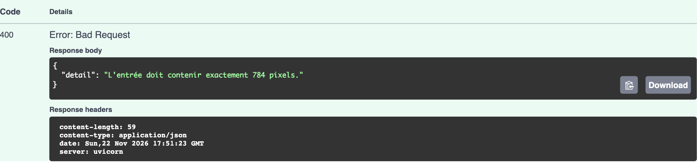

```json
{"detail": "L'entrée doit contenir exactement 784 pixels."}
```

La requête est rejetée en **400** avant tout calcul : le modèle n'est jamais appelé. Deux autres cas ont été vérifiés :
un champ mal nommé (`image` au lieu de `pixels`) et des valeurs non numériques. Pydantic les rejette en **422** avant
même d'entrer dans la fonction. Un fichier qui n'est pas une image envoyé à `/predict/image` reçoit un **400**
« Le fichier envoyé n'est pas une image lisible. »

---

## 7. Photos réelles : adaptation automatique

### 7.1 Le problème

Le modèle n'a vu que des images 28×28 très particulières : objet **clair sur fond noir**, détouré, recadré, centré.
Une photo de téléphone (objet sombre sur fond clair, en couleur, décentré, en 4000×3000) en est très loin ; l'envoyer
telle quelle, même réduite à 28×28, donne des prédictions sans valeur.

### 7.2 Le pipeline `preprocessing.py`

Le module reproduit la façon dont Zalando a fabriqué Fashion-MNIST à partir de ses photos produit :

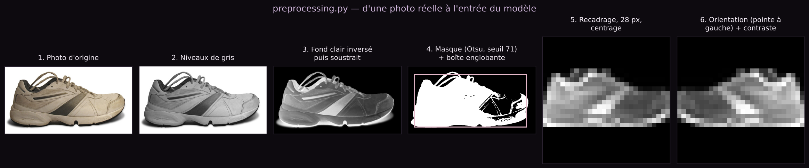

| # | Étape | Pourquoi |
|---|---|---|
| 1 | Correction EXIF, fond transparent → blanc, niveaux de gris, réduction à 512 px max | Photo de téléphone orientée correctement, PNG détourés gérés, calcul rapide |
| 2 | Fond estimé par la **médiane des bords** ; inversion si le fond est clair | Fashion-MNIST = objet clair sur fond noir |
| 3 | Soustraction du fond, filtre médian 3×3 | Le fond devient vraiment noir, le bruit du capteur disparaît |
| 4 | Masque par **seuil d'Otsu**, boîte englobante sur les percentiles 0,5–99,5 % | Détourage automatique, robuste aux poussières isolées |
| 5 | Recadrage, côté le plus long → 28 px (Lanczos), centrage sur un carré noir | Même cadrage que le dataset, proportions conservées |
| 6 | **Orientation** : un objet couché dont le côté haut est à gauche est retourné | Dans Fashion-MNIST, toutes les chaussures ont la pointe à gauche |
| 7 | Étirement du contraste (99ᵉ percentile → 255) | Plage d'intensités comparable aux images d'entraînement |

Les photos HEIC d'iPhone sont lues grâce à `pillow-heif`. Seuls NumPy et Pillow sont utilisés : pas d'OpenCV ni de
modèle de détourage lourd, ce qui garde le déploiement léger.

### 7.3 Validation

**Photos simulées.** 500 images du jeu de test ont été transformées en « photos produit » : objet inversé sur fond
clair légèrement teinté, agrandi entre 250 et 600 px, décalé aléatoirement, bruit gaussien, compression JPEG. Après
prétraitement, **85,6 %** sont bien classées, contre 87,8 % pour les mêmes images d'origine : la chaîne ne perd
presque rien.

**L'orientation, découverte par un test réel.** Lors d'un premier essai, une basket photographiée pointe à droite
était classée *Bag* à 100 %. En retournant l'image, elle devenait *Sneaker* à 99 %. Le dataset ne contient en effet
que des chaussures pointe à gauche. Choisir l'orientation au cas par cas selon la confiance du modèle faisait baisser
la précision sur les images normales (88 % → 81 %). La règle retenue est géométrique et déterministe : pour un objet
plus large que haut, si le tiers gauche est plus haut que le tiers droit (talon, tige de bottine), on retourne.

| Jeu (3 000 images) | Sans règle | Avec règle |
|---|---:|---:|
| Images d'origine | 87,9 % | 87,9 % |
| Images retournées en miroir | 67,4 % | **80,3 %** |

La règle ne dégrade rien sur les données normales et corrige les trois quarts des chaussures retournées.

**Vraies photos.** Six photos de Wikimedia Commons, très différentes (fond rouge, fond blanc, fond noir, objet
ajouré, paire de chaussures) :

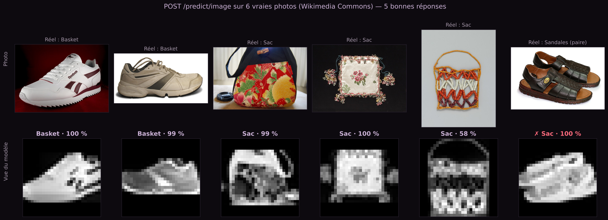

| Photo | Prédiction | Confiance | Résultat |
|---|---|---:|:---:|
| Basket Reebok, fond rouge | Sneaker | 1,00 | ✅ |
| Basket de sport, fond blanc | Sneaker | 0,99 | ✅ |
| Sac en tissu | Bag | 0,99 | ✅ |
| Réticule ancien (LACMA), fond noir | Bag | 1,00 | ✅ |
| Sac en perles (filet) | Bag | 0,58 | ✅ hésitant |
| Paire de sandales | Bag | 1,00 | ❌ |

L'échec est instructif : deux sandales qui se chevauchent forment un seul bloc, et le modèle, qui n'a jamais vu deux
objets dans une même image, y voit un sac. L'interface conseille donc de photographier **une seule pièce, entière,
sur fond uni**.

---

## 8. L'interface Streamlit

### 8.1 Intention

L'interface s'adresse à quelqu'un qui ne sait pas ce qu'est un logit. Elle reprend les codes d'une boutique de mode
en ligne : fond sombre violacé, titres en serif (*Cormorant Garamond*), texte en *Inter*, cartes produit numérotées,
boutons en pilule. Aucun terme technique dans le parcours principal.

| Analyse d'une vraie photo | Galerie de la collection |
|---|---|
| 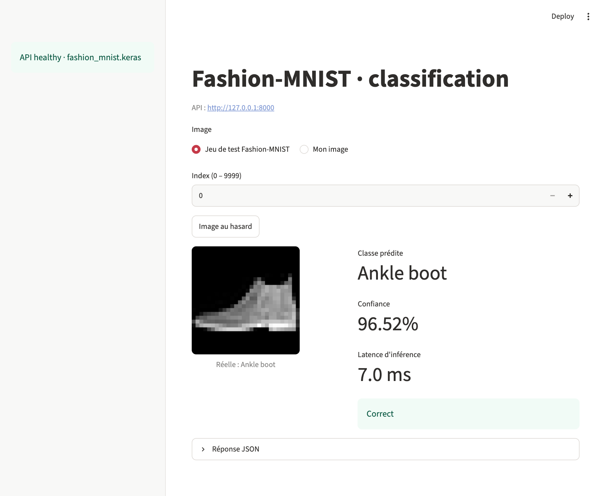 | 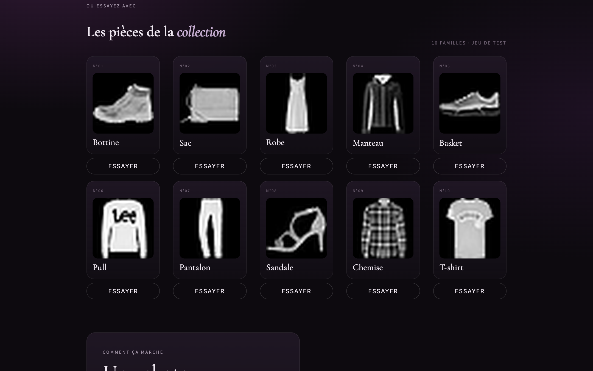 |

### 8.2 Parcours

1. **Votre pièce** : import d'une photo (JPG, PNG, WEBP, HEIC) ou prise de vue directe avec l'appareil photo.
2. **Notre lecture** : nom de la pièce en français (« Basket ») avec le nom d'origine en petit, une phrase de
   confiance plutôt qu'un chiffre brut, une barre, les deux autres pistes, et à côté de la photo **l'image 28×28 que
   le modèle a réellement vue**. Cette vignette rend le prétraitement visible et explique les erreurs.
3. **La collection** : dix pièces du jeu de test, une par famille, à essayer en un clic. Le résultat s'ouvre dans
   une fenêtre et indique si le modèle a raison.

| Confiance | Phrase affichée |
|---|---|
| ≥ 90 % | Sans hésitation |
| 70 – 90 % | Très probablement |
| 50 – 70 % | Probablement |
| < 50 % | Le modèle hésite |

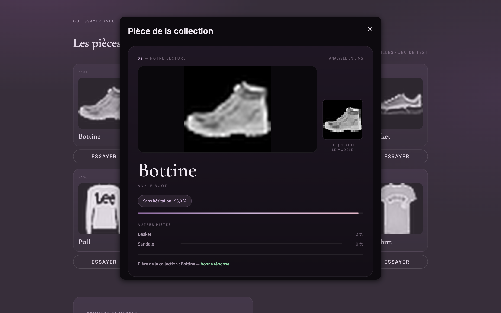

### 8.3 Détails techniques

- Mise en forme : CSS injecté via `st.markdown`, polices Google Fonts, thème dans `.streamlit/config.toml`,
  en-tête et menu Streamlit masqués.
- `st.cache_resource` pour la connexion à l'API, `st.cache_data` pour les prédictions : une même photo n'est
  analysée qu'une fois.
- La galerie ouvre ses résultats dans un `st.dialog` : sans cela, le résultat s'affichait en haut de page pendant
  que l'utilisateur regardait la galerie en bas.

---

## 9. Déploiement

### 9.1 En local

```bash
python3.12 -m venv .venv && source .venv/bin/activate
pip install -r requirements.txt
uvicorn app:app --reload            # API      → http://127.0.0.1:8000/docs
streamlit run streamlit_app.py      # interface → http://localhost:8501
```

### 9.2 Docker

```bash
docker compose up -d --build        # API :8000 + interface :8501
```

L'image part de `python:3.12-slim`, écoute sur `$PORT` (8000 par défaut) et déclare un `HEALTHCHECK` sur `/health`.
Le service `front` ne démarre que lorsque l'API est déclarée saine. Le Dockerfile est fourni prêt à l'emploi ; son
build n'a pas été vérifié dans le cadre de ce TP.

### 9.3 Streamlit Community Cloud

Streamlit Cloud n'exécute **que** l'application Streamlit : il n'y a pas de serveur FastAPI à côté. Le front choisit
donc sa façon de joindre l'API :

| Situation | Accès à l'API |
|---|---|
| Variable `API_URL` définie | HTTP vers cette API (Docker, VM, autre hébergeur) |
| Une API répond sur le port 8000 | HTTP local |
| Aucune API (Streamlit Cloud) | `app.py` chargé dans le process, appelé via `fastapi.testclient.TestClient` |

**Incident et correction.** La première version lançait Uvicorn dans un thread du conteneur Streamlit. Au démarrage
à froid, TensorFlow mettait plus longtemps à se charger que le délai d'attente : la page s'affichait avant le serveur,
mettait en cache l'échec, et l'utilisateur voyait « API injoignable ». Avec `TestClient`, chaque requête passe toujours
par les vraies routes `/health`, `/predict` et `/predict/image` (validation Pydantic, erreurs 400/422 comprises), mais
sans serveur ni port réseau : plus aucune course au démarrage.

---

## 10. Réponses aux questions d'analyse

<details open>
<summary><b>Q1. Pourquoi le modèle reçoit-il une entrée de forme (1, 28, 28) ?</b></summary>

Un modèle Keras traite toujours des lots : sa forme d'entrée est `(None, 28, 28)`, où `None` est la taille du batch.
Pour une seule image on construit un batch de taille 1. La couche `Flatten` transforme ensuite chaque image 28×28 en
vecteur de 784 valeurs.
</details>

<details>
<summary><b>Q2. Pourquoi l'API vérifie-t-elle la présence de 784 pixels ?</b></summary>

784 = 28 × 28. Avec un autre nombre de valeurs, le `reshape` échouerait et le client recevrait une erreur 500 peu
claire. Le contrôle en amont renvoie un 400 explicite, sans gaspiller de calcul, et protège contre un mauvais
aplatissement côté client.
</details>

<details>
<summary><b>Q3. Pourquoi diviser les pixels par 255 lorsque leur valeur maximale dépasse 1 ?</b></summary>

Le modèle a été entraîné sur des pixels dans [0, 1]. L'inférence doit reproduire exactement ce prétraitement, sinon
les activations sont multipliées par 255 et les prédictions n'ont plus de sens. Le test `max > 1` accepte les deux
formats : la même image envoyée en 0–255 ou en 0–1 donne exactement la même réponse (Ankle boot, 0,9652).
</details>

<details>
<summary><b>Q4. Quelle différence entre logits et probabilités ?</b></summary>

Les logits sont les sorties brutes de la dernière couche linéaire : des réels quelconques, positifs ou négatifs, dont
la somme n'a pas de sens. Les probabilités sont comprises entre 0 et 1 et leur somme vaut 1 sur les dix classes.
</details>

<details>
<summary><b>Q5. Pourquoi applique-t-on une fonction softmax ?</b></summary>

`softmax(zᵢ) = exp(zᵢ) / Σ exp(zⱼ)` transforme les logits en distribution de probabilité. Étant croissante, elle ne
change pas la classe retenue par l'argmax, mais elle donne un score de confiance interprétable.
</details>

<details>
<summary><b>Q6. Pourquoi le modèle est-il chargé une seule fois au démarrage ?</b></summary>

Charger le modèle (lecture du fichier, reconstruction de l'architecture, allocation des poids) prend de l'ordre de la
seconde, contre environ 2 ms pour une inférence. Le recharger à chaque requête multiplierait la latence et la
consommation mémoire.
</details>

<details>
<summary><b>Q7. Quelle différence entre <code>model.fit()</code> et <code>model(image, training=False)</code> ?</b></summary>

`fit()` entraîne : passes avant, calcul de la perte, rétropropagation, mise à jour des poids, sur plusieurs époques.
`model(image, training=False)` fait une seule passe avant, sans gradient ni modification des poids ; `training=False`
met aussi les couches comme Dropout ou BatchNormalization en mode inférence.
</details>

<details>
<summary><b>Q8. Que représente la latence retournée par l'API ?</b></summary>

Le temps de l'appel au modèle seul, mesuré avec `time.perf_counter()`. Elle exclut le réseau, la lecture du JSON et
le prétraitement. Côté client, le temps total est d'environ 6,3 ms pour 2,4 ms d'inférence : l'écart vient de la
sérialisation JSON et du transport HTTP.
</details>

<details>
<summary><b>Q9. Quel est le rôle de la route <code>/health</code> ?</b></summary>

C'est une sonde de supervision : sans lancer d'inférence, elle indique que le serveur répond et que le modèle est
chargé. Le `HEALTHCHECK` Docker, Kubernetes ou un répartiteur de charge s'en servent pour décider d'envoyer du trafic
ou de redémarrer le service.
</details>

<details>
<summary><b>Q10. Quels éléments constituent le contrat d'inférence ?</b></summary>

La route et la méthode, le format d'entrée, le prétraitement, le modèle et ses formes, le format de sortie, la liste
ordonnée des classes et les codes d'erreur. Voir le tableau du [§5.2](#52-contrat-dinférence).
</details>

---

## 11. Limites et pistes

- **Architecture du modèle.** Un MLP ignore la structure spatiale de l'image ; un petit CNN gagnerait plusieurs
  points, surtout sur les hauts (T-shirt / Pullover / Coat / Shirt) et sur Sneaker / Sandal.
- **Confiance ≠ certitude.** L'image 12 est fausse à 93 %. Un seuil (par exemple 0,7) sous lequel l'API marquerait la
  prédiction comme incertaine serait plus honnête ; l'interface le fait déjà en mots.
- **Photos réelles.** Le détourage par seuil suppose un fond uni. Un fond chargé ou plusieurs objets mettent la
  chaîne en défaut ; un modèle de segmentation (rembg, SAM) lèverait cette limite au prix d'un déploiement plus lourd.
- **Domaine.** Le modèle ne connaît que 10 familles, apprises sur des photos de catalogue Zalando : une veste en jean
  portée, photographiée en biais, reste un cas difficile.

---

## 12. Reproduire

```bash
git clone https://github.com/toubani12/fashion-mnist-fastapi.git
cd fashion-mnist-fastapi
python3.12 -m venv .venv && source .venv/bin/activate
pip install -r requirements.txt

uvicorn app:app &                   # API
python test_api.py                  # tests → resultats.json + captures/image_testee.png
streamlit run streamlit_app.py      # interface
```

---

### Crédits

- Jeu de données : [Fashion-MNIST](https://github.com/zalandoresearch/fashion-mnist), Zalando Research (licence MIT).
- Photos de test (Wikimedia Commons, licences indiquées sur chaque page) :
  [basket Reebok](https://commons.wikimedia.org/wiki/File:Reebok_Royal_Glide_Ripple_Clip_shoe.jpg),
  [basket de sport](https://commons.wikimedia.org/wiki/File:Shoes_sport-right.jpg),
  [sandales](https://commons.wikimedia.org/wiki/File:Men%27s_size_10_Sandals.jpg),
  [sac](https://commons.wikimedia.org/wiki/File:Bag_(2).jpg),
  [sac en perles](https://commons.wikimedia.org/wiki/File:Beaded_Bag.jpg),
  [réticule, LACMA](https://commons.wikimedia.org/wiki/File:Woman%27s_Bag_(Reticule)_LACMA_M.83.281.2_(1_of_2).jpg).
- Modèle et énoncé : Pr. Asmae OUHMIDA, ENSET Mohammedia.

**Badr Eddine TOUBANI** — Master SDIA 2, ENSET Mohammedia · [github.com/toubani12](https://github.com/toubani12)
